<!-- _class: s1 -->

# AI-assisted research programming

**Stay in control**
*with UU AI Chat + local Python/R + Git*

 

Qixiang Fang
Utrecht University Programming Café · Oct 22, 2026

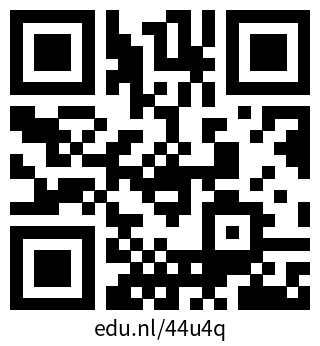

---

<!-- _class: s2 -->

# About me

- Name: Qixiang [kis-jang] Fang
- Postdoc at ODISSEI Social Data Science (SoDa) Team
  - Provide research support and training
  - AI methodology research
- Academic background:
  - PhD in NLP
  - MSc in Statistics
  - BAs in behavioural and social sciences

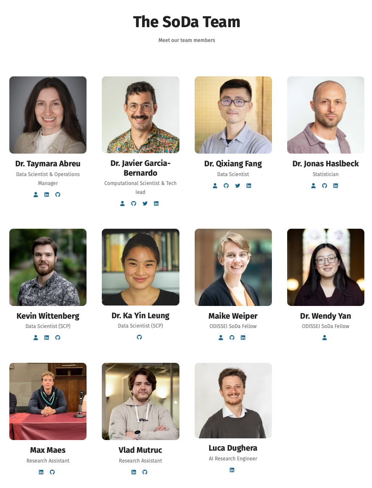

---

<!-- _class: s3 -->

# What is your experience with AI-assisted research programming?

- Who are you?
- Do you use AI for research code? For what tasks?
- How has it changed your research workflow?
- What do you like/dislike about it?

---

<!-- _class: s4 -->

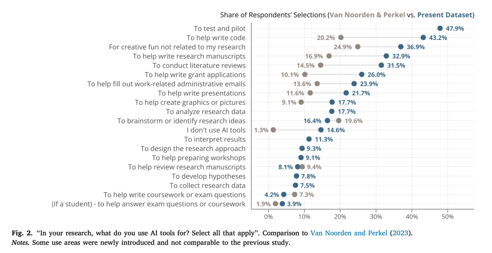
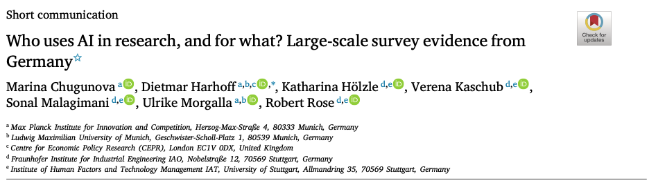

<!-- Slide 4: Survey results: research uses of AI; Who uses AI in research, and for what? -->

---

<!-- _class: s5 -->

# A Codex example

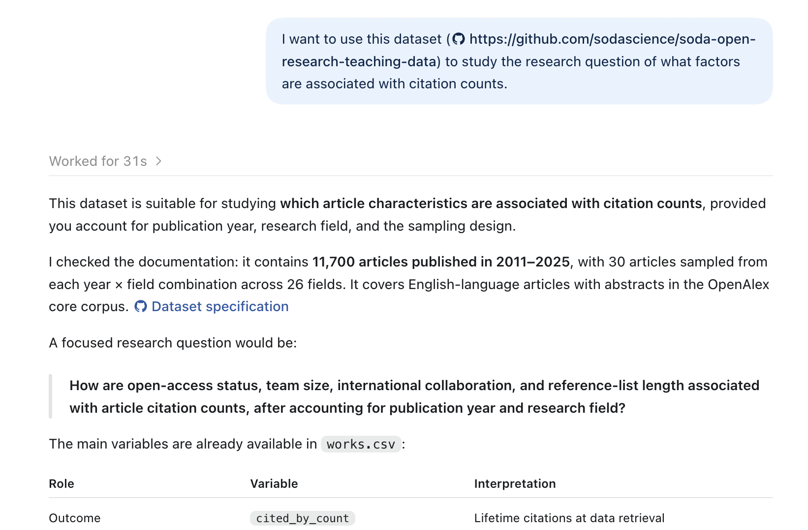

---

<!-- _class: s6 -->

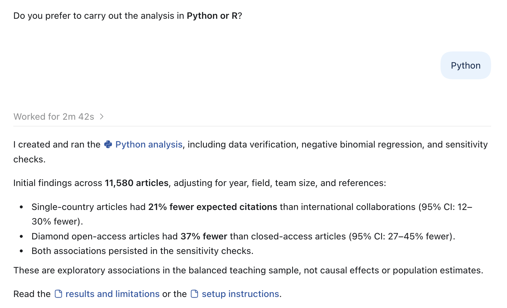

<!-- Slide 6: Codex analysis response -->

---

<!-- _class: s7 -->

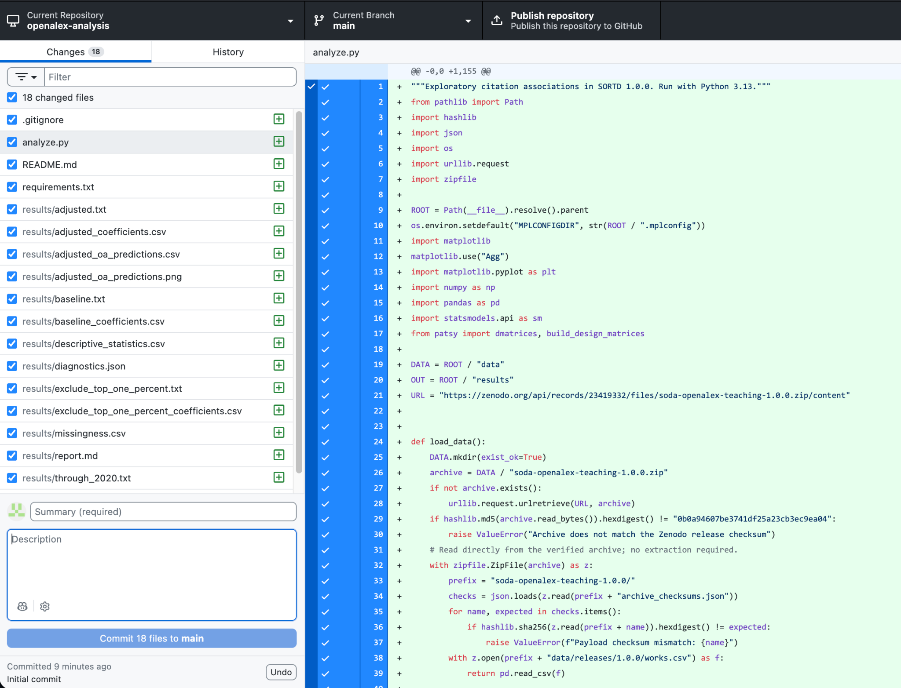

<!-- Slide 7: Codex example: changed files -->

---

<!-- _class: s8 -->

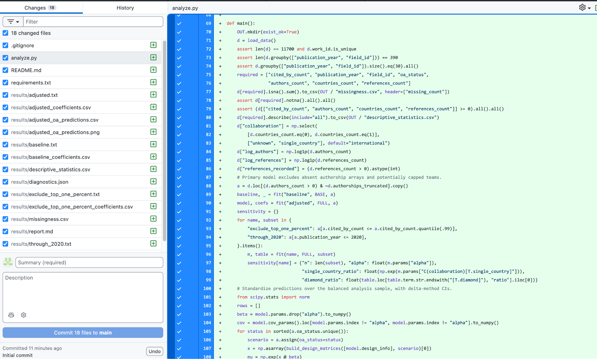

<!-- Slide 8: Codex example: generated changes -->

---

<!-- _class: s9 -->

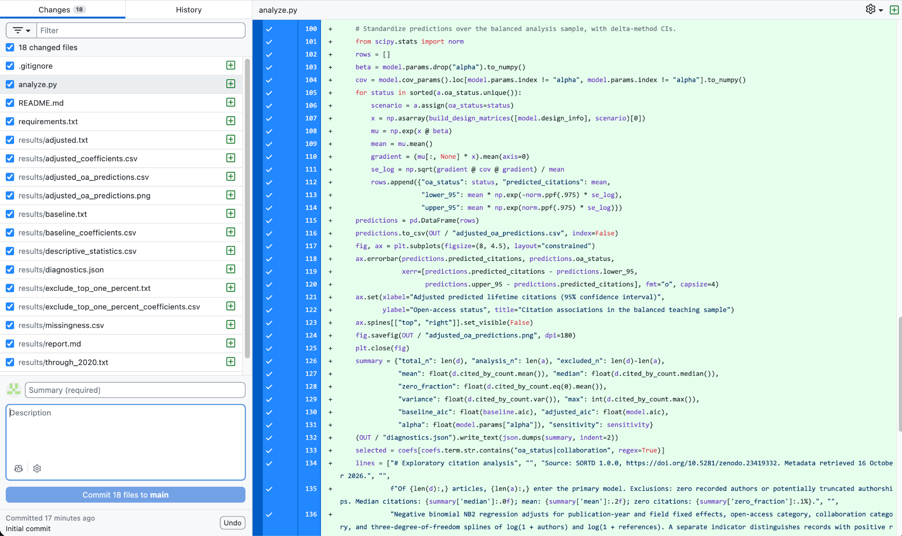

<!-- Slide 9: Codex example: generated analysis code -->

---

<!-- _class: s10 -->

# Challenges of AI-assisted coding

- Lack of understanding of the generated code
- Difficulty in debugging and troubleshooting
- Losing control over the research process
- Over-reliance on AI-generated code
- etc.

---

<!-- _class: s11 -->

# Your role as researcher

When using AI:

- AI does not replace your expertise.
- Any AI output should be inspected and challenged.
- Adjust your expectations: Maybe don't cram what in the past would be three-months of work into one day.

---

<!-- _class: s12 -->

# Your role as researcher

Using AI or not:

- Own the research questions, data and decisions.
- Understand any change (e.g., code, analysis) well enough to explain it.
- Validate the results.
- Reproduce the study.

---

<!-- _class: s13 -->

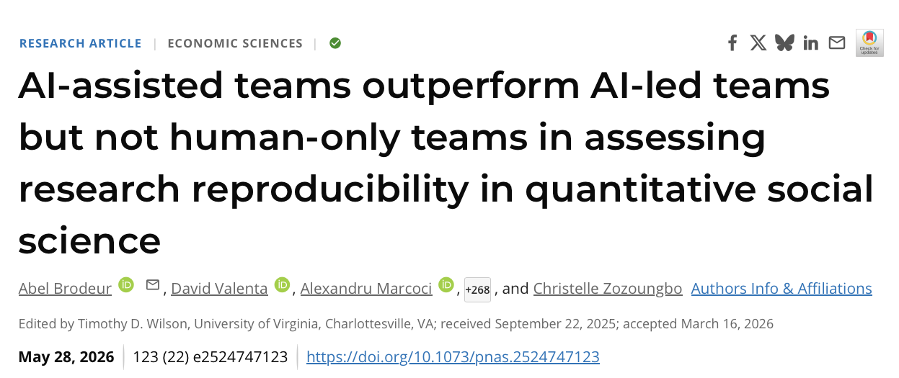

<!-- Slide 13: AI-assisted teams and research reproducibility -->

---

<!-- _class: s14 -->

# Workshop goals

Target: researchers with (limited) programming experience

You will learn:

- Plan and review plan before AI-assisted coding
- Divide work into small, verifiable units
- Transfer, check, inspect the diff, commit
- Resume from updated project state

**Disclaimer**: Personal experience and opinions; feedback welcome.

---

<!-- _class: s15 -->

# Proposed workflow

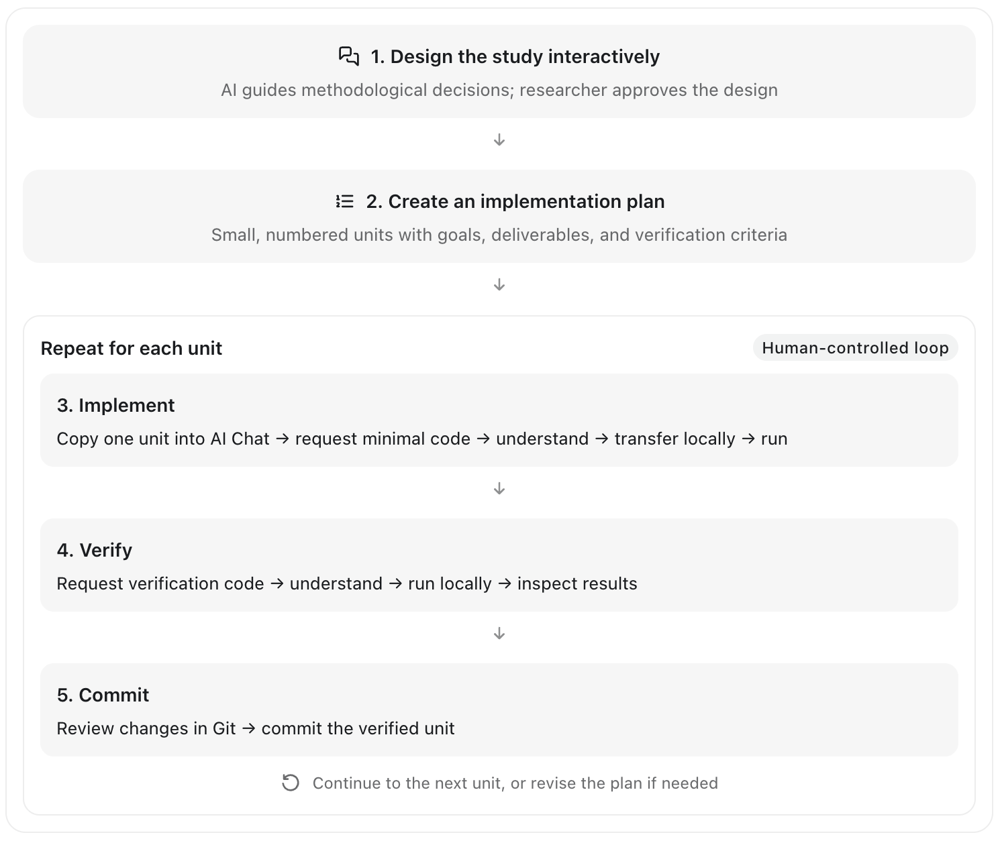

---

<!-- _class: s16 -->

# Workshop toolkit

**Local editor + Python/R:** save files, execute, inspect outputs

**Git and GitHub desktop:** inspect changes and save checkpoints

---

<!-- _class: s17 -->

# Workshop toolkit

UU AI Chat: discuss, plan, propose code, debug

https://aichat.uu.nl

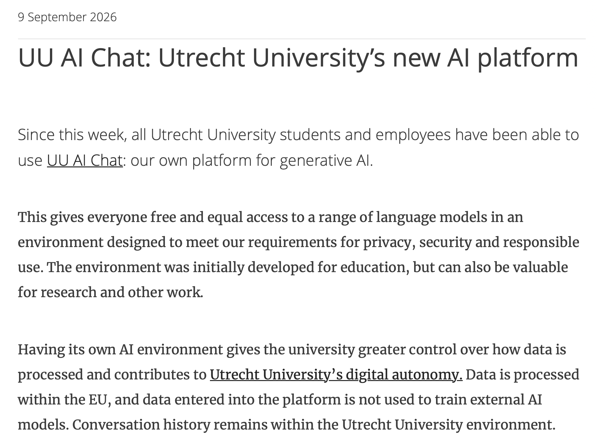

---

<!-- _class: s18 -->

Note: The chat cannot directly read or edit your local project.

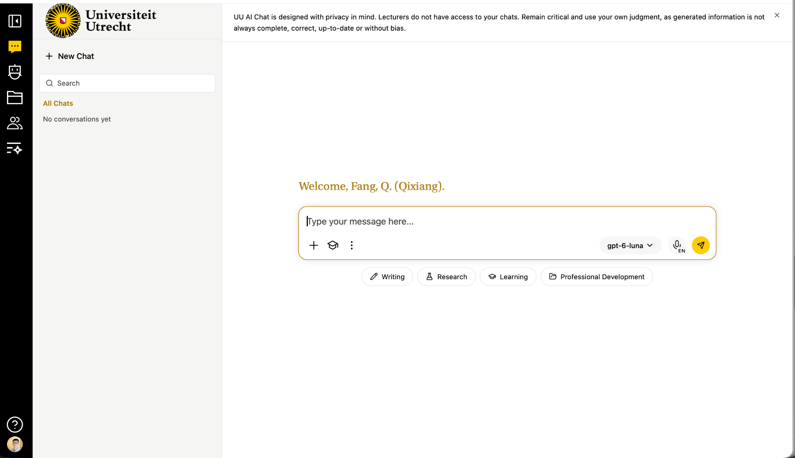

---

<!-- _class: s19 -->

# Workshop toolkit

**SoDa Open Research Teaching Datasets (SORTD):**

- 11,700 works · 2011–2025 · 26 primary fields
- 30 works per year × field
- English articles with abstracts
- Includes:
  - `works.csv`,
  - `abstracts.csv`,
  - `authors.csv`,
  - `funding.csv`,
  - `topics.csv`
  - etc.

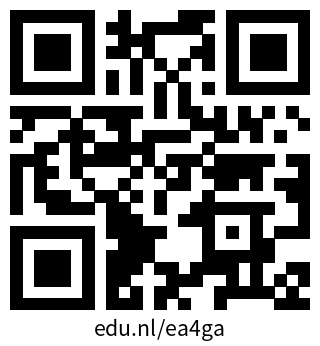

---

<!-- _class: s20 -->

# Example research questions

What factors are associated with

- citation counts?
- open access (OA) publication?
- retraction?

---

<!-- _class: s21 -->

# Demo: Research question

What factors are associated with

- citation counts?
- ~~open access (OA) publication?~~
- ~~retraction?~~

---

<!-- _class: s22 -->

# 0. Basic local setup

- Create a local Git-tracked repository
- Gather existing work/resources/files
  - Study description
  - Data
  - Code
  - etc.

---

<!-- _class: s23 -->

# 1. Design

- Create a project in UU AI Chat and start Chat 1.
  - Attach a study design template, and use an appropriate prompt.
- Answer the questions.
  - Review the proposed choices and ask for revisions where needed.
  - Keep uncertain decisions labelled as provisional.
- Approve the design when ready.
- Save it locally, review the saved file, and commit it when ready.

---

<!-- _class: s24 -->

# 2. Plan

- Start Chat 2 in the same project.
  - Attach the approved study design and an implementation plan template, then use an appropriate prompt.
- Check that the plan follows the design.
  - Does each unit have one small goal, clear inputs, a deliverable, and checks you can understand?
- Ask to split any unit that feels too large.
- Review and approve the plan, save it locally and commit it.

---

<!-- _class: s25 -->

# 3. Implement (one unit)

- Start Chat 3 in the same project.
  - Attach both study design and implementation plan.
  - Ask: “Implement Unit # only.”
  - Read the response. Ask about anything you do not understand.

- Save, run and inspect code
  - Save the suggested code or files locally and run any code using the provided instructions.
  - Inspect the result.

- If something fails:
  - Share the error, expected behaviour, and relevant code.
  - Ask: “Explain the cause and suggest the smallest fix for this unit."
  - Apply a fix you understand, then rerun the unit and its checks.

---

<!-- _class: s26 -->

# 4. Verify!

- Ask: “Provide independent verification checks for Unit # against its requirements.”
- Read and run the checks locally. Compare outputs with the requirements.
- Report which checks passed. Resolve any unexplained failures before continuing.

---

<!-- _class: s27 -->

# 5. Commit

- Inspect the changed files in your editor or GitHub Desktop.
- Confirm the changes match the requested unit and include no unrelated edits.
- Stage only the intended implementation and verification files.
- Commit with a short message describing the change.
- Tell Chat 3 the unit is verified and committed before requesting another unit.

---

<!-- _class: s28 -->

# Rinse and repeat 2-5

---

<!-- _class: s29 -->

# Questions?

---

<!-- _class: s30 -->

# Exercise

What factors are associated with

- citation counts?
- open access (OA) publication?
- retraction?

Go to [exercises/README.md](../exercises/README.md)

---

<!-- _class: s31 -->

# Discussion

- What worked and what didn't?
- How do you like this AI-assisted coding approach?
- Any other question?

---

<!-- _class: s32 -->

# Take home

Design → plan → implement → verify → commit

Update project, then repeat.
